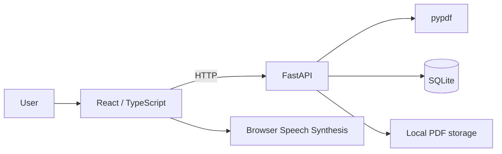

# LUNA — Offline-First PDF Reader & Browser Narration

LUNA is a local reading app for importing and organizing PDF books, opening them in a browser viewer, and listening to selectable text using browser text-to-speech. It explores frontend/backend integration, local file handling, and SQLite persistence.

> **Status:** Student project under active development. Working, partial and planned features are identified separately.

## Highlights
- PDF import with file-size and PDF-header validation
- Document title and page-count extraction
- Local SQLite library records
- FastAPI backend with React + TypeScript frontend
- Library search/filter interface
- Browser-native PDF viewer
- Page-level PDF text extraction endpoint
- Browser Speech Synthesis narration (does not create audio files)
- Local developer diagnostics and Windows launcher

## Architecture


## Technology
Frontend: React, TypeScript, Vite  
Backend: Python, FastAPI, Uvicorn  
PDF: pypdf  
Database: SQLite  
Narration: Browser Speech Synthesis

## Run locally (Windows)

Backend terminal:
```powershell
cd backend
python -m venv .venv
.\.venv\Scripts\Activate.ps1
pip install -r requirements.txt
python -m uvicorn main:app --reload --host 127.0.0.1 --port 8000
```

Frontend in a second terminal:
```powershell
cd frontend
npm install
npm run dev
```
Open the localhost URL Vite prints (usually port 5173). Backend API docs are at `http://127.0.0.1:8000/docs`.

## API overview
| Method | Endpoint | Purpose |
|---|---|---|
| GET | `/api/health` | Health check |
| GET | `/api/books` | List books |
| POST | `/api/books/import` | Import PDF |
| GET | `/api/books/{id}/pdf` | Stream PDF |
| GET | `/api/books/{id}/text?page=1` | Extract page text |

## Feature status
| Feature | Status |
|---|---|
| PDF import, metadata extraction, SQLite record | Backend implemented |
| PDF streaming | Endpoint implemented |
| Library search/filter | UI exists; verify current build |
| PDF reader | Basic browser-native viewer |
| Page text extraction | Endpoint implemented; not full-book indexing |
| Narration | Browser voices; selectable text |
| Playlists / persistent reading progress | Partial / verify implementation |
| OCR, offline TTS engine, generated audio files | Planned |

## Repository layout
- `backend/` — FastAPI endpoints, database logic and dependencies
- `frontend/` — React/TypeScript UI
- `docs/` — learning guide and project notes
- `local-data/` — local library and database runtime files (keep user books out of git)

## Limitations
- Designed for local use, not a production multi-user service.
- Narration relies on browser/OS voices and does not export MP3/WAV.
- Scanned PDFs need OCR, not currently included.
- Native PDF viewer controls can vary between browsers.
- Persistence of progress/playlists should be confirmed in the current implementation.
- Optional ESP32 hardware is a separate idea; not required to run the software.

## Learning focus
Local-first design · REST APIs · file validation/storage · SQLite · React state · PDF processing · integration debugging.

**Author:** Mohammed Suhail · ECE student