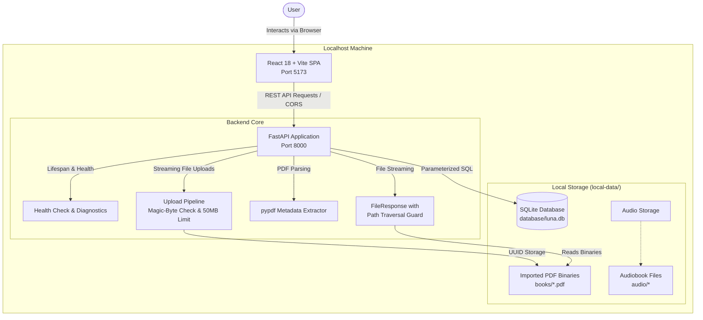
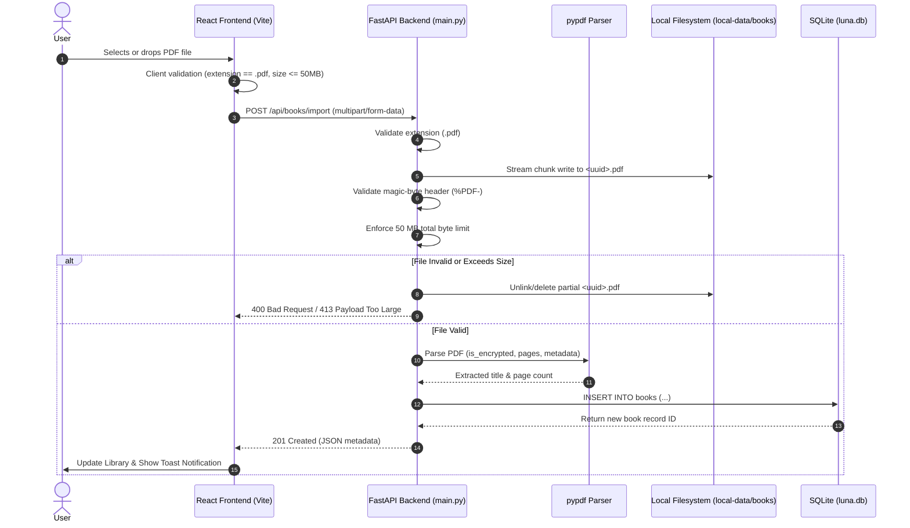

# LUNA — eBook Reader & Audiobook Player

> **An offline-first platform for reading PDF books and listening to audiobooks.**

[](LICENSE)
[](https://www.python.org/)
[](https://fastapi.tiangolo.com/)
[](https://react.dev/)
[](https://www.typescriptlang.org/)
[](https://vitejs.dev/)
[](https://www.sqlite.org/)

---

## Table of Contents

- [Project Overview](#project-overview)
- [Key Features](#key-features)
- [System Architecture](#system-architecture)
- [Technology Stack](#technology-stack)
- [Screenshots & Visual Gallery](#screenshots--visual-gallery)
- [Prerequisites](#prerequisites)
- [Installation & Setup](#installation--setup)
- [Running the Application](#running-the-application)
- [API Reference & Usage Examples](#api-reference--usage-examples)
- [Data Flow & Ingestion](#data-flow--ingestion)
- [Project Structure](#project-structure)
- [Configuration](#configuration)
- [Testing & Build](#testing--build)
- [Troubleshooting](#troubleshooting)
- [Security & Limitations](#security--limitations)
- [Project Roadmap](#roadmap)
- [Contributing](#contributing)
- [License & Acknowledgements](#license--acknowledgements)

---

## Project Overview

**LUNA** is a standalone, offline-first digital reading and audio companion application. It bridges the gap between visual document reading and auditory learning by combining a PDF library reader with an integrated audiobook player within a cohesive, distraction-free environment.

### The Problem It Solves

Modern eBook and audiobook applications frequently impose proprietary DRM formats, continuous cloud connectivity requirements, subscription walls, and intrusive telemetry. Readers who own local PDF documents or value privacy often struggle to find a streamlined, self-contained application that manages both their reading library and listening queue locally on their machine.

### Core Philosophy

1. **Offline-First & Sovereign**: Zero cloud telemetry, mandatory remote logins, or external database calls. Your books, reading progress, and database reside strictly on your local disk in `local-data/`.
2. **Resource-Conscious & Clean**: High-speed FastAPI backend serving a lightweight, modern React 18 single-page application styled with pure CSS design tokens and zero bloated UI frameworks.
3. **Decoupled Architecture**: Designed from the ground up as a fully independent software application. While an optional low-power companion hardware device (such as an ESP32 e-paper reader) may be explored in the future, **no physical hardware is required** to use LUNA.

### Target Audience

- **Students & Evaluators**: Seeking an end-to-end, full-stack demonstration of offline data management, file processing, and API design.
- **Readers & Self-Learners**: Looking for an elegant, distraction-free reader for technical books, research papers, and documents.
- **Developers & Contributors**: Interested in local-first storage patterns, PDF stream processing, and minimalist React architecture.

---

## Key Features

### Implemented and Prototype Capabilities

 > Feature labels below distinguish implemented functionality from prototypes. The frontend can request selectable text from a PDF page and pass it to the browser's built-in Speech Synthesis API. This is browser-based narration, not generation or storage of audiobook files. Check the [Learning Handbook](docs/learning-guide/README.md) for implementation details and limitations.

| Capability | Status | Description |
|---|---|---|
| **Secure PDF Ingestion** | Working | Streamed file upload with 50 MB ceiling, `%PDF-` magic-byte validation, and automated orphan file cleanup on failure. |
| **Automatic Metadata Extraction** | Working | Parses page counts and embedded document titles directly from PDF binaries via `pypdf`, falling back gracefully to clean filenames. |
| **Local SQLite Persistence** | Working | Relational storage in `local-data/database/luna.db` with parameterized queries and automated directory/schema initialization. |
| **Path-Traversal Protected Streaming** | Working | PDF binary delivery endpoint (`/api/books/{id}/pdf`) strictly verifies canonical paths inside `local-data/books/` before streaming. |
| **Library Management UI** | Working | Grid and list catalog views, real-time title/filename search, category filtering, and document details inspection. |
| **PDF Reader** | Basic PDF viewing implemented | Displays the original imported PDF through the browser's built-in PDF viewer, served by the local FastAPI backend. Page controls request a page via the PDF viewer URL fragment; browser PDF-viewer behavior may vary. Custom PDF.js rendering and connecting extracted text to the reader UI are not implemented yet. |
| **Reader bookmarks** | Implemented in browser storage | Bookmark/unbookmark the current page for each book. Bookmarks are stored in this browser's `localStorage` and survive refreshes in the same browser profile; they are not synchronized between devices or users and may be cleared with browser data. |
| **Browser-based PDF narration** | Basic implementation | The frontend requests selectable page text from the local API and uses the browser's Speech Synthesis API. No MP3/WAV file is generated or cached; voice availability depends on the browser/OS. Accurate seeking and total duration are unavailable. |
| **Dashboard** | Partial | Library-backed counts can be shown, while activity history and other reading statistics may still be demonstration data. |
| **Developer Mode** | Local diagnostics | Password-gated developer diagnostics, backend/library checks, and JSON report export. See [Developer Mode documentation](docs/developer-mode/README.md); the shared default code is local-development only. |
| **Windows Launcher** | Available; verify locally | `start-luna.bat` starts separate backend/frontend windows and waits for ports. It has not been verified on every Windows/PowerShell setup. |

### In-Progress & Planned Features

- **In-Progress (UI-Driven)**: Audiobook playlist creation and manual chapter management are currently operated in the client-side state machine pending dedicated backend playlist persistence endpoints.
- **Partially implemented**: `GET /api/books/{id}/text?page=1` extracts selectable text from one page on demand. It is not yet connected to the Reader UI, does not save extracted text, and cannot OCR scanned pages.
- **Planned**: OCR for scanned PDFs, durable playback/reading progress, semantic PDF outline/chapter extraction, and a true seekable audio-file pipeline. Current narration depends on the browser speech engine and selectable PDF text.
- **Planned (Optional Accessory)**: Experimental USB/Bluetooth synchronization module for external ESP32-based e-paper displays.

---

## System Architecture

LUNA operates on a decoupled client-server architecture hosted entirely on the local loopback interface (`127.0.0.1`):



---

## Technology Stack

The repository uses a local-first stack with no paid cloud API requirement. For exact installed frontend package versions, use `frontend/package.json` and `frontend/package-lock.json`; for Python dependencies, use `backend/requirements.txt`.

| Component | Technology | Version | Purpose & Implementation Details |
|---|---|---|---|
| **Backend Framework** | FastAPI | `^0.115` | High-performance asynchronous REST API framework with automatic OpenAPI documentation. |
| **ASGI Server** | Uvicorn | `[standard]` | Production-grade ASGI web server running with hot-reloading on port 8000. |
| **PDF Engine** | pypdf | `^5.0` | Pure-Python PDF parser for page counting, encryption inspection, and metadata extraction. |
| **Multipart Parser** | python-multipart | `*` | Handles multipart form-data streams for file ingestion without loading entire payloads into RAM. |
| **Database** | SQLite3 | Native Python | Embedded relational database engine stored at `local-data/database/luna.db`. |
| **Frontend Framework** | React | See `frontend/package.json` | Declarative UI layer utilizing hooks and custom context state management. |
| **Language** | TypeScript | See `frontend/package.json` | Static type safety across all frontend components, models, and API adapters. |
| **Build Tool & Bundler** | Vite | `5.4.8` | Ultra-fast development server with Hot Module Replacement (HMR) and optimized rollup production bundling. |
| **Iconography** | Lucide React | See `frontend/package.json` | SVG icon set used throughout the UI. |
| **Styling** | Vanilla CSS | CSS custom properties | Bespoke design system using native CSS variables and component styles. |

---

## Screenshots & Visual Gallery

> [!NOTE]
> The screenshots below illustrate key application views. Place your actual UI captures in `docs/screenshots/` using the filenames indicated below.

| View | Relative Asset Path | Description |
|---|---|---|
| **Dashboard** | `docs/screenshots/dashboard.png` | Library overview, reading streaks, recent books, and system status indicator. |
| **Book Library** | `docs/screenshots/library.png` | Book catalog with grid/list toggle, live search, and PDF drag-and-drop import modal. |
| **Distraction-Free Reader** | `docs/screenshots/reader.png` | Full-screen reading canvas with font controls, theme toggles, and table of contents. |
| **Audiobook Player** | `docs/screenshots/player.png` | Browser speech controls and elapsed-time display. Seeking/total duration are not reliably supported by Speech Synthesis. |

### How to Capture & Update Project Screenshots
1. Launch LUNA locally using the instructions below.
2. Create the folder: `mkdir docs/screenshots`
3. Save your captures with the names: `dashboard.png`, `library.png`, `reader.png`, and `player.png`.
4. Commit the images to your repository to have them render natively on GitHub.

---

## Prerequisites

Before setting up LUNA, ensure your local development environment has:

- **Python**: Version `3.10` or higher (`python --version`)
- **Node.js**: Version `18.x` or higher and **npm** (`node --version`, `npm --version`)
- **Operating System**: Windows 10/11, macOS, or Linux
- **Hardware Requirement**: None. LUNA runs entirely on your desktop or laptop.

---

## Installation & Setup

### 1. Clone the Repository

```bash
git clone https://github.com/mdxsuhail/luna.git
cd luna
```

### 2. Backend Environment Setup

#### Windows (PowerShell)
```powershell
# Navigate to the backend directory
cd backend

# Create virtual environment
python -m venv .venv

# Activate virtual environment
.\.venv\Scripts\Activate.ps1

# Install required dependencies
pip install -r requirements.txt
```

#### macOS / Linux
```bash
# Navigate to the backend directory
cd backend

# Create virtual environment
python3 -m venv .venv

# Activate virtual environment
source .venv/bin/activate

# Install required dependencies
pip install -r requirements.txt
```

### 3. Frontend Environment Setup

Open a **second terminal window** and navigate to the `frontend` directory:

```bash
cd frontend

# Install exact dependencies from package-lock.json
npm install
```

---

## Running the Application

### Option A: Automated Launch (Windows Only)

A Windows batch launcher is provided in the repository root. Its behavior can vary by machine; if it fails, use the manual commands below:

```cmd
start-luna.bat
```

### Option B: Manual Execution (Any Platform)

Run the backend and frontend in two separate terminal windows.

#### Terminal 1 — FastAPI Backend (Port 8000)

From the `backend` folder with the virtual environment activated:

```powershell
# Windows
.venv\Scripts\python.exe -m uvicorn main:app --host 127.0.0.1 --port 8000 --reload

# macOS / Linux
python -m uvicorn main:app --host 127.0.0.1 --port 8000 --reload
```

- **Health Endpoint**: `http://127.0.0.1:8000/api/health`
- **Interactive OpenAPI Documentation**: `http://127.0.0.1:8000/docs`

#### Terminal 2 — Vite Frontend (Port 5173)

From the `frontend` folder:

```bash
npm run dev
```

Once both servers are running, navigate to **`http://localhost:5173`** in your browser.

---

## API Reference & Usage Examples

The FastAPI backend exposes REST endpoints under `/api`. All responses are formatted as JSON, except binary file transfers.

### 1. Health Status Check

Verifies backend operations, SQLite database file availability, and storage directory paths.

- **Endpoint**: `GET /api/health`
- **Request Example**:
  ```powershell
  # PowerShell
  Invoke-RestMethod -Uri "http://127.0.0.1:8000/api/health" -Method Get
  ```
  ```bash
  # cURL
  curl -X GET "http://127.0.0.1:8000/api/health"
  ```
- **Verified Response (`200 OK`)**:
  ```json
  {
    "status": "healthy",
    "app": "LUNA API",
    "database_initialized": true
  }
  ```

### 2. List All Imported Books

Returns an array of all books stored in SQLite ordered by ID descending.

- **Endpoint**: `GET /api/books`
- **Request Example**:
  ```bash
  curl -X GET "http://127.0.0.1:8000/api/books"
  ```
- **Verified Response (`200 OK`)**:
  ```json
  [
    {
      "id": 1,
      "title": "Clean Architecture",
      "original_filename": "clean_arch.pdf",
      "stored_pdf_path": "local-data/books/a1b2c3d4e5f6.pdf",
      "page_count": 352,
      "import_timestamp": "2026-10-17 21:00:00",
      "extracted_text_status": "pending"
    }
  ]
  ```

### 3. Import a PDF Document

Streams a PDF file to `local-data/books/`, inspects header bytes, parses metadata, and registers a record in SQLite.

- **Endpoint**: `POST /api/books/import`
- **Content-Type**: `multipart/form-data`
- **Constraints**: Must have `.pdf` extension, `%PDF-` initial bytes, and be $\le 50\text{ MB}$.
- **Request Example**:
  ```bash
  curl -X POST "http://127.0.0.1:8000/api/books/import" \
       -F "file=@/path/to/sample.pdf"
  ```
- **Verified Response (`201 Created`)**:
  ```json
  {
    "id": 2,
    "title": "Sample Document Title",
    "original_filename": "sample.pdf",
    "stored_pdf_path": "local-data/books/789a0b1c2d3e.pdf",
    "page_count": 42,
    "import_timestamp": "2026-10-17 21:30:00",
    "extracted_text_status": "pending"
  }
  ```

### 4. Stream PDF Content

Securely delivers the raw binary PDF stream with path traversal verification.

- **Endpoint**: `GET /api/books/{book_id}/pdf`
- **Response**: `application/pdf` binary stream with filename disposition headers.

---

## Data Flow & Ingestion

The sequence below illustrates the verified import process from the React user interface to disk persistence:



---

## Learning Handbook (Recommended for Students)

The source code is accompanied by a step-by-step engineering handbook designed to help you explain the project during a college evaluation:

- [Open the LUNA Learning Handbook](docs/learning-guide/README.md)
- Architecture and end-to-end data flow
- Backend, SQLite schema, PDF ingestion and path-safety controls
- Frontend components, shared React state and API calls
- PDF text extraction and browser-based narration
- Current UI behavior, developer access gate, debugging and viva preparation

**Documentation rule:** when a code change changes behavior, update the relevant handbook chapter and this README in the same pull request. Clearly label what is implemented, prototype-only, or planned. Never describe a UI control as persistent unless the implementation writes to disk/database or another durable store.

---

## Project Structure

```
luna/
├── backend/
│   ├── .venv/                      # Python virtual environment (ignored by git)
│   ├── database.py                 # SQLite configuration, schema initialization, and queries
│   ├── main.py                     # FastAPI application, CORS rules, and REST endpoints
│   └── requirements.txt            # Python dependencies (fastapi, uvicorn, pypdf, python-multipart)
├── frontend/
│   ├── index.html                  # HTML entry point and application title
│   ├── package.json                # Frontend package dependencies and npm scripts
│   ├── package-lock.json           # Locked dependency tree for deterministic installations
│   ├── tsconfig.json               # TypeScript compiler configuration
│   ├── vite.config.ts              # Vite dev server and build configuration
│   └── src/
│       ├── App.tsx                 # Core layout wrapper, sidebar, and routing switch
│       ├── main.tsx                # React DOM root entry point
│       ├── index.css               # Design system, CSS variables, themes, and layout styles
│       ├── components/             # Reusable UI component blocks
│       │   ├── common/             # Modals, status banners, buttons
│       │   ├── layout/             # Header, Sidebar, Persistent Audio Player
│       │   └── library/            # BookCard, BookListRow
│       ├── context/
│       │   └── AppContext.tsx      # Global React state (active book, library, audio, reader)
│       ├── data/
│       │   └── mockData.ts         # Fallback data models and initial statistics
│       ├── pages/                  # Page-level components
│       │   ├── AudiobooksPage.tsx  # Audiobook collection and chapter view
│       │   ├── DashboardPage.tsx   # Reading activity overview and statistics
│       │   ├── DevicePage.tsx      # Optional hardware companion status screen
│       │   ├── LibraryPage.tsx     # Book catalog, search, category filters, and PDF upload
│       │   ├── PlaylistsPage.tsx   # Custom listening playlists
│       │   ├── ReaderPage.tsx      # Document reader canvas with themes and typography tools
│       │   └── SettingsPage.tsx    # Appearance, cache management, and storage diagnostics
│       ├── services/
│       │   └── api.ts              # Centralized backend HTTP client and data adaptors
│       └── types/
│           └── index.ts            # TypeScript interfaces (Book, ApiBook, Chapter, Playlist)
├── local-data/                     # Local data root (ignored by git)
│   ├── audio/                      # Reserved directory for local audiobook files
│   ├── books/                      # Ingested PDF documents stored as <uuid>.pdf
│   └── database/
│       └── luna.db                 # Primary SQLite database file
├── docs/                           # Documentation assets
├── optional-device/                # Experimental companion hardware source files
├── start-luna.bat                  # One-click Windows development launcher script
├── LICENSE                         # Official Apache 2.0 License
└── README.md                       # Project documentation
```

---

## Configuration

LUNA can run locally without a `.env` file. Developer Mode has a convenience default code for local development; because the fallback is visible in this public repository, it is not suitable for a network-facing deployment. Optional local overrides are documented in [Developer Mode](docs/developer-mode/README.md).

### Verified Internal Defaults

| Configuration Parameter | File Location | Default Value | Description |
|---|---|---|---|
| **API Host & Port** | `backend/main.py` | `127.0.0.1:8000` | Loopback address for FastAPI ASGI server. |
| **Frontend Dev Server** | `frontend/vite.config.ts` | `localhost:5173` | Vite development server host and port. |
| **Max PDF Upload Size** | `backend/main.py` | `52,428,800 bytes (50 MB)` | Strict ceiling enforced during streaming file ingestion. |
| **Streaming Chunk Size** | `backend/main.py` | `1,048,576 bytes (1 MB)` | Memory-safe chunk buffer size for upload writing. |
| **CORS Whitelist** | `backend/main.py` | `http://localhost:5173`, `http://127.0.0.1:5173` | Permitted origins for frontend browser communication. |
| **SQLite File Path** | `backend/database.py` | `local-data/database/luna.db` | Relative to the project root directory. |
| **PDF Storage Directory** | `backend/database.py` | `local-data/books/` | Relative to the project root directory. |

---

## Testing & Build

### Frontend Production Build
To validate TypeScript types and compile a production-ready bundle:

```bash
cd frontend

# Run TypeScript type check followed by Vite bundle compilation
npm run build
```

The resulting assets will be compiled to `frontend/dist/`. To preview the production bundle locally:

```bash
npm run preview
```

### Automated Checks
GitHub Actions runs backend unit tests, the frontend TypeScript/Vite production build, responsive browser checks, and dependency-security audits on pushes and pull requests. Check the Actions tab for the latest result. Passing automated checks does not replace a manual end-to-end PDF import/delete/open test.

### Backend & API Verification
You can verify backend routes interactively via Swagger UI:
1. Start the backend: `.venv\Scripts\python.exe -m uvicorn main:app --reload`
2. Open `http://127.0.0.1:8000/docs` in your browser.
3. Test `/api/health`, `/api/books`, and `/api/books/import` using FastAPI's interactive testing console.

---

## Troubleshooting

### 1. `ERR_CONNECTION_REFUSED` at `http://localhost:5173`
- **Cause**: The Vite frontend development server is not running or was launched before its dependencies were installed.
- **Resolution**:
  1. Open a terminal in `frontend/`.
  2. Confirm `node_modules` exists; run `npm install` if missing.
  3. Start the server with `npm run dev` and ensure the output confirms `VITE ready in ... ms`.

### 2. `Could not retrieve books from SQLite. Backend is unreachable`
- **Cause**: The FastAPI server on `http://127.0.0.1:8000` is offline or failed during startup.
- **Resolution**:
  1. Verify the backend status: `curl http://127.0.0.1:8000/api/health`
  2. If inactive, start the backend from `backend/`:
     ```powershell
     .\.venv\Scripts\Activate.ps1
     python -m uvicorn main:app --host 127.0.0.1 --port 8000 --reload
     ```
  3. Ensure no firewall or third-party antivirus is blocking port `8000`.

### 3. Port `8000` or `5173` Is Already in Use (`WinError 10048`)
- **Cause**: A previous server instance is still bound to the target socket.
- **Resolution** (Windows PowerShell):
  ```powershell
  # Locate the PID occupying port 8000 or 5173
  netstat -ano | findstr ":8000 :5173"

  # Terminate the lingering process by PID
  taskkill /F /PID <PID_NUMBER>
  ```

### 4. PDF Import Fails with `Invalid PDF file format` or `413 Request Entity Too Large`
- **Cause**: The file exceeds 50 MB, is missing standard `%PDF-` header bytes, or is password-protected.
- **Resolution**:
  - Verify that the document size is under 50 MB.
  - Open the PDF in a standard viewer to ensure it is not corrupt or encrypted with a password.

### 5. `The filename, directory name, or volume label syntax is incorrect`
- **Cause**: Windows CMD quotation nesting issue when running batch commands.
- **Resolution**: Use the updated root [start-luna.bat](start-luna.bat) which correctly passes `/D "<dir>"` working directories to `start` and prevents nested quote stripping.

---

## Security & Limitations

- **Local-only boundary**: LUNA is a local desktop prototype. Although account and developer-gate endpoints exist, they are not a substitute for a security-reviewed, network-facing authentication system. Keep the API bound to `127.0.0.1`; do not expose it to a LAN or the internet.
- **Host and cross-origin checks**: The backend rejects non-loopback Host values and rejects cross-origin state-changing requests when a browser supplies an untrusted Origin. CORS is restricted to the local Vite origins, required methods, and headers. These checks reduce browser-based abuse but do not replace authentication for a network-facing deployment.
- **Path traversal guard**: PDF streaming and text extraction resolve registered filenames and reject paths or symlinks that escape `local-data/books/`.
- **Resource limits**: PDF uploads are limited to 50 MB, documents over 20,000 pages are rejected, and one page-text response is capped at 1,000,000 characters. These are guardrails, not a guarantee against every malicious PDF parser denial-of-service.
- **Reduced diagnostic disclosure**: The health endpoint does not return absolute local filesystem paths.
- **Developer Mode**: the default developer code and fallback signing secret are public local-development defaults. Use private overrides in an untracked `backend/.env`; never expose the backend beyond loopback while using defaults. See `docs/developer-mode/README.md`.
- **Dependency checks**: CI runs Python dependency auditing and an npm audit threshold for high-severity production dependencies.
- **Encrypted PDF handling**: Password-protected PDFs that cannot be unlocked are rejected.
- **Local data**: Metadata and imported books live in `local-data/`. Back up this folder before making destructive changes.

---

## Roadmap

### Current Focus
- [x] Streamlined local PDF file ingestion and metadata extraction (`pypdf`)
- [x] SQLite database schema and persistence layer
- [x] Responsive React + Vite desktop UI with multi-theme reader and persistent audio player
- [x] Safe streaming file endpoints with traversal protection
- [x] Automated Windows startup script (`start-luna.bat`)

### Next Steps
- [ ] **Custom PDF Rendering**: Replace browser-native PDF viewing with a PDF.js canvas renderer for consistent controls and deeper reading integration.
- [ ] **Backend Text Extraction**: Worker pipeline to update `extracted_text_status` from `pending` to `complete`, populating page-by-page searchable text.
- [ ] **Local Text-to-Speech (TTS)**: Integration with local Python TTS libraries (such as Piper or Coqui) for on-device voice generation.
- [ ] **Reading Progress Sync**: Storing current page numbers and percentage read directly in SQLite.
- [ ] **Decoupled Hardware Integration**: Optional USB/Bluetooth synchronization protocol for external ESP32 e-paper reading devices.

---

## Contributing

Contributions from students, readers, and open-source developers are welcome:

1. **Fork** the repository on GitHub.
2. **Create a branch** for your feature or bug fix:
   ```bash
   git checkout -b feature/your-feature-name
   ```
3. **Commit your modifications** with clear, descriptive commit messages:
   ```bash
   git commit -m "Add canvas page navigation to Reader component"
   ```
4. **Test your changes** locally by running both backend and frontend servers.
5. **Push** to your fork:
   ```bash
   git push origin feature/your-feature-name
   ```
6. **Open a Pull Request** describing the motivation, implementation, and verified behavior of your change.

---

## License & Acknowledgements

### License

This project is licensed under the **Apache License 2.0**. See the [LICENSE](LICENSE) file for complete details.

### Acknowledgements

- [FastAPI](https://fastapi.tiangolo.com/) by Sebastián Ramírez for the asynchronous backend framework.
- [pypdf](https://github.com/py-pdf/pypdf) for offline PDF processing and metadata extraction.
- [React](https://react.dev/) & [Vite](https://vitejs.dev/) for the frontend developer experience and build tooling.
- [Lucide](https://lucide.dev/) for clean, open-source iconography.

---

<p align="center">
  <sub>LUNA is an active, open-source offline-first reading platform developed for readers and learners.</sub>
</p>

## Editorial interface

The interface includes an About LUNA mission page, a book-spine Shelf view in the library, folder-style dashboard panels, and a cassette-inspired playlist queue. These are responsive UI components built around existing app state; audio synthesis remains under development. See [the editorial UI notes](docs/editorial-ui.md).
