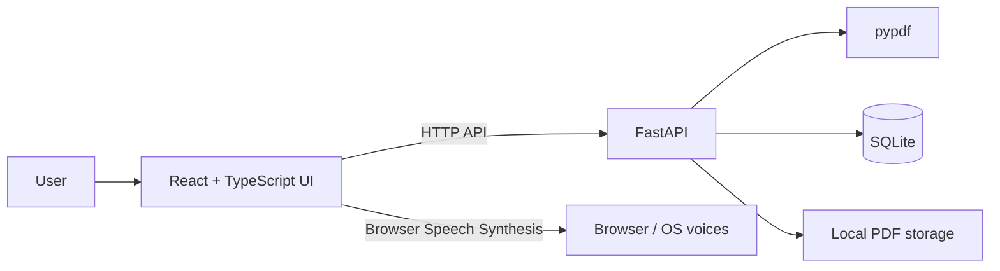

# LUNA — Offline-First PDF Reader & Browser Narration

LUNA is a local-first reading application for importing and organizing PDF books, opening them in a reader, and using browser text-to-speech to listen to selectable PDF text. It is a software project exploring frontend/backend integration, local file handling, and a small SQLite-backed library.

> **Status:** Student project in active development. The README distinguishes working features from partial and planned features; see the project docs and code for the current details.

## Highlights

- PDF import with file-size and PDF-header checks.
- Extracts document title and page count.
- Stores book metadata in local SQLite.
- Local FastAPI backend with book-list, import, text extraction and PDF-stream endpoints.
- React frontend built with Vite and TypeScript.
- Library search and category filtering.
- Browser-native PDF viewing.
- Browser Speech Synthesis narration for selectable PDF text (not saved audio files).
- Local developer diagnostics and Windows startup script.

## Architecture



The app is designed for local use. The optional hardware companion concept is not required to run the software.

## Stack

| Layer | Technologies |
|---|---|
| Frontend | React, TypeScript, Vite |
| Backend | Python, FastAPI, Uvicorn |
| PDF | pypdf |
| Data | SQLite |
| Narration | Browser Speech Synthesis |
| Development | Git, npm, Python virtual environment |

## Run locally (Windows)

### 1. Backend

From the project root, open PowerShell:

```powershell
cd backend
python -m venv .venv
.\.venv\Scripts\Activate.ps1
pip install -r requirements.txt
python -m uvicorn main:app --reload --host 127.0.0.1 --port 8000
```

### 2. Frontend

Open another terminal:

```powershell
cd frontend
npm install
npm run dev
```

Open the local address printed by Vite (typically `http://localhost:5173`). The frontend expects the backend to be running on port 8000.

## API endpoints (current backend)

| Method | Endpoint | Purpose |
|---|---|---|
| GET | `/api/health` | Backend status |
| GET | `/api/books` | List imported books |
| POST | `/api/books/import` | Import a PDF |
| GET | `/api/books/{id}/pdf` | Stream a stored PDF |
| GET | `/api/books/{id}/text?page=1` | Extract text from one page |

Use the FastAPI interactive docs at `http://127.0.0.1:8000/docs` when the backend is running.

## Feature status

| Feature | Status |
|---|---|
| PDF import and metadata | Implemented in backend |
| SQLite library records | Implemented |
| PDF stream endpoint | Implemented |
| Library UI/search/filter | Implemented or present; verify in current build |
| Browser PDF reader | Basic/native viewer |
| Page text extraction endpoint | Implemented; not full-document indexing |
| Browser text-to-speech | Basic; requires selectable text and supported browser voices |
| Playlist persistence | In progress/client state; not claimed as durable backend feature |
| OCR, local TTS engine, saved audio files | Planned |

## Repository map

- `backend/` — FastAPI routes, SQLite database code, backend dependencies
- `frontend/` — React/TypeScript UI
- `docs/` — learning notes and project documentation
- `start-luna.bat` — Windows launcher, if present
- `local-data/` — runtime library storage (should not be committed)

## Limitations

- Designed as a local desktop-style app, not a production-hosted multi-user service.
- Narration uses the browser's speech engine; it does not generate downloadable audiobook files.
- Scanned PDFs need OCR, which is not currently included.
- Page navigation and PDF viewing behavior depend on the browser's native PDF viewer.
- Reading progress and playlist features may not be persisted across sessions; verify current implementation before relying on them.
- Optional ESP32 companion hardware is a separate future experiment and not a requirement for LUNA.

## What I'm learning from this project

Local-first application architecture · REST API design · file validation and storage · SQLite persistence · React state · PDF processing · integration debugging · documentation.

## Contributing / feedback

Issues, suggestions, and improvements are welcome. If you try the project, please report bugs or usability feedback through GitHub Issues.

---

**Author:** Mohammed Suhail · Electronics & Communication Engineering student
