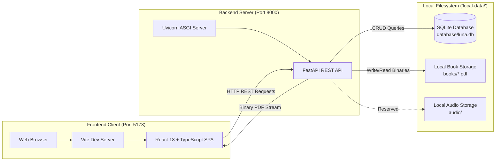
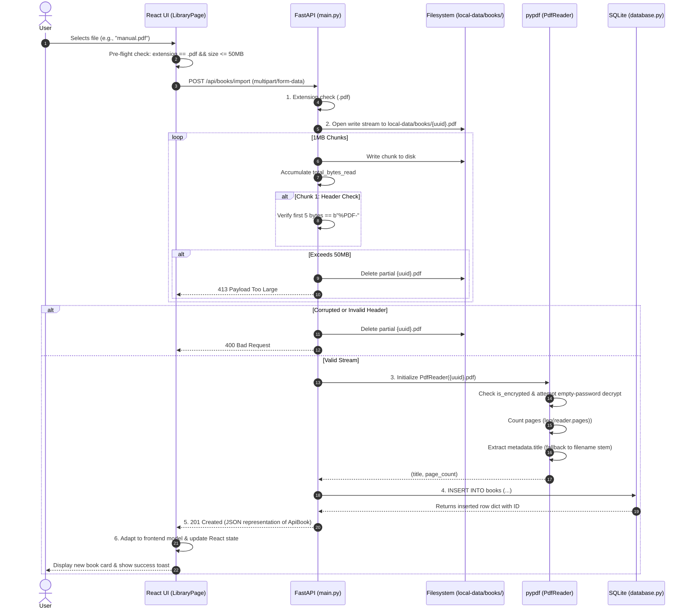
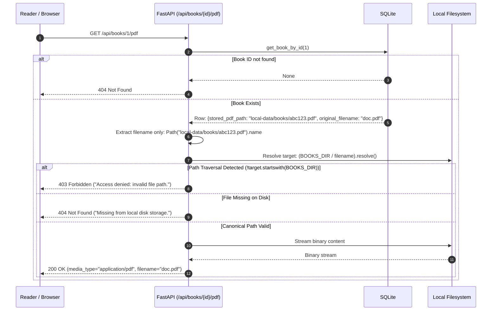

# Module 01: Architecture & Data Flow

This module explains the overarching architectural philosophy, system topology, component interactions, and data pipelines of the **LUNA** platform.

---

## 1. Architectural Philosophy: Why Offline-First?

LUNA is engineered as an **offline-first, local-first** application. Understanding what this means—and why it was designed this way—is critical for architectural evaluations and college viva exams.

```
Traditional Cloud Reading Apps               LUNA Offline-First Architecture
┌───────────────────────────────┐            ┌───────────────────────────────┐
│ User Device (Browser / App)   │            │ Host Machine (127.0.0.1)      │
│  │                            │            │  │                            │
│  ▼ HTTPS                      │            │  ▼ Loopback HTTP              │
│ Cloud API Gateway             │            │ FastAPI Local Server (8000)   │
│  │                            │            │  │                            │
│  ▼ Remote Worker              │            │  ▼ Local System Calls         │
│ AWS S3 / Cloud Storage        │            │ `local-data/books/*.pdf`      │
│  │                            │            │  │                            │
│  ▼ Remote Query               │            │  ▼ Local I/O                  │
│ PostgreSQL / Supabase         │            │ `local-data/database/luna.db` │
└───────────────────────────────┘            └───────────────────────────────┘
Risks: Latency, tracking, paywalls,         Benefits: Zero latency, total privacy,
requires constant Internet connection.       no external servers, lifetime data access.
```

### Core Design Tenets:
1. **Loopback Network Isolation**: The application exclusively binds to `127.0.0.1` (localhost). No inbound public network interface is opened, eliminating external network attack vectors.
2. **Zero Remote Telemetry**: No third-party analytical SDKs (Google Analytics, Mixpanel, Sentry) are included in the frontend bundle.
3. **Sovereign File & Metadata Storage**: When a user imports a PDF, the file is saved locally to `local-data/books/`, and its structured metadata is recorded in an embedded SQLite file (`local-data/database/luna.db`).
4. **Complete Decoupling from Hardware**: While the repository includes an `optional-device/` directory reserved for future microcontroller experiments (e.g., an ESP32 e-ink reader), LUNA is built as a complete desktop software application that requires zero physical peripherals to run.

---

## 2. System Topology & Component Roles

LUNA consists of two discrete processes communicating over standard HTTP/REST:



### Component Breakdown

| Layer | Technology | Primary Responsibilities |
|---|---|---|
| **Presentation Layer** | React 18, TypeScript, Pure CSS | Renders responsive UI (Dashboard, Library, Reader, Audio Player). Manages client-side state machine through React Context (`AppContext`). |
| **Transport Layer** | HTTP/1.1 over Loopback | JSON payloads for API requests/responses; `multipart/form-data` for file uploads; `application/pdf` binary streams for reading. |
| **API & Business Logic** | FastAPI (Python 3.10+) | Validates file uploads, enforces size limits, executes `pypdf` parsing, guards against path-traversal attacks, and handles application lifespan. |
| **Data Persistence** | SQLite 3 & Local Disk | Stores relational records in `local-data/database/luna.db` and binary documents in `local-data/books/`. |

---

## 3. Data Flow: PDF Ingestion & Validation

When a user imports a PDF book, LUNA executes a secure, 6-step streaming ingestion pipeline:



### Critical Implementation Details:
- **Memory Safety**: Rather than reading the entire file into server RAM using `await file.read()`, the backend reads and writes in **1 MB chunks** (`CHUNK_SIZE = 1024 * 1024`). A 50 MB upload consumes only 1 MB of working memory on the server.
- **Magic-Byte Header Validation**: Extension spoofing (renaming `malware.exe` to `document.pdf`) is caught immediately on chunk 1 by checking `chunk.startswith(b"%PDF-")`.
- **Orphan File Cleanup**: If PDF parsing fails, the file exceeds 50 MB, or the SQLite transaction aborts, the newly created UUID file is immediately purged from disk using `destination_path.unlink(missing_ok=True)`.

---

## 4. Data Flow: Safe PDF Retrieval & Streaming

When a book is opened in the reader or downloaded, LUNA streams the binary PDF through `/api/books/{id}/pdf`:



### The Path-Traversal Defense Mechanism
Path traversal attacks attempt to access unauthorized system files (such as `C:\Windows\System32\drivers\etc\hosts` or `../../etc/passwd`) by manipulating stored path strings. LUNA neutralizes this risk in `backend/main.py`:
1. Strips any relative directory components from the stored database string using `Path(stored_path_str).name`.
2. Resolves the absolute canonical path: `target_file = (BOOKS_DIR / filename_only).resolve()`.
3. Asserts that the canonical path string strictly starts with the resolved `BOOKS_DIR` path prefix. If it does not, an HTTP 403 Forbidden is raised immediately.

---

## 5. Storage Directory Structure

All persistent state is stored in `local-data/` at the project root. This directory is included in `.gitignore` to prevent committing private documents or binary artifacts into version control:

```
local-data/
├── database/
│   └── luna.db         # SQLite 3 database file containing metadata tables
├── books/
│   ├── 8f4e2b1a...pdf  # Isolated, UUID-named PDF documents
│   └── c9d31a7f...pdf
└── audio/              # Reserved for companion audio files and voice synthesis
```

Directory generation is idempotent. The `ensure_directories()` function in `backend/database.py` guarantees that all three subdirectories exist before any database connection or file write is attempted.
